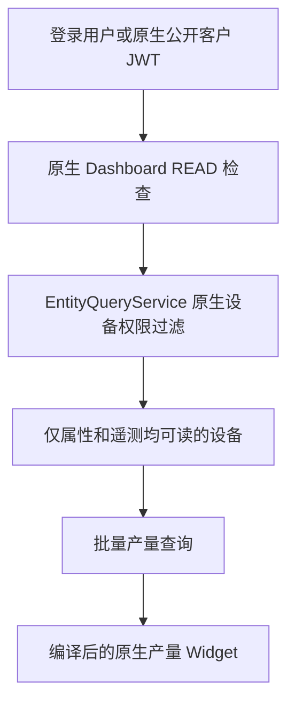

# 设备产量多类型大屏需求与程序设计交接

日期：2026-11-06，Asia/Shanghai。本文记录需求、实现架构与交付检查，附录保留视觉原型。

目标是在现有 ThingsBoard PE 项目中实现可复用的设备产量大屏：支持全部类型、指定类型和单台设备，固定容量、整页轮播，一屏显示。复用现有产量统计、Dashboard、Widget 和 RBAC。

## 1 授权范围与最新决策

用户已授权本地代码实现，明确先不要部署。本次不修改生产数据、不推送镜像、不部署、不提交 Git。

用户最新确认：**集合大屏使用原生公开链接和权限管理**。不新增发布者权限、设备白名单、独立密钥、匿名业务路由或发布表。此前独立集合发布设计已删除。旧单机大屏链接继续兼容。

月均速度最新口径：本月产量 ÷ 已过自然统计时长，包含停机、断报和离线，未来时间不进入分母。

当前工作区已有算法修复与隐藏“数据不完整”的行为均保留；本功能不改变原始采集和既有计数算法。实际验证结果见末尾实施记录。

## 2 需求清单

每页三类、二十秒间隔及具体主题样式是当前建议默认值，不是用户单独确认过的技术参数。固定容量、整页轮播及多类型展示是用户已确定的方向。最新补充：左侧设备菜单允许独立纵向滚动，右侧大屏内容和整页不滚动。

| 编号 | 需求 |
| --- | --- |
| R01 | 用于电视或大屏展示，支持全屏和 iframe，参考已有免登录产量大屏链接。 |
| R02 | 右侧内容单屏完整呈现，整页不产生横纵滚动；左侧分组设备菜单允许独立纵向滚动，不能裁切右侧内容冒充适配。 |
| R03 | 默认可看全部设备，并能切换某种类型、某台设备。全部指当前看板有效授权范围。 |
| R04 | 支持折页机、印刷机、装订机等类型标签，类型数量不能硬编码为三种。 |
| R05 | 按类型汇总。同类型通常使用相同单位，不同单位不能直接相加。 |
| R06 | 除列表和数字外，需要图表，包括产量趋势、设备产量及班次对比。 |
| R07 | 采用固定容量、整页轮播，不随类型数量增加持续缩小文字和图表。 |
| R08 | 示例容量为每页最多三类，十类分四页，依次为三类、三类、三类、一类。末页少量卡片保持尺寸并居中。 |
| R09 | 建议轮播间隔二十秒。手动翻页、进入类型或设备时暂停，可显式恢复。 |
| R10 | 同一套展示支持日间和夜间风格，改善密集表格、层级不清和图表过小的问题。 |
| R11 | 永久链接不因普通发版、服务重启失效，支持生成、复制、重置和停用。永久不表示脱离授权或永远不可撤销。 |
| R12 | 遵循现有租户、客户层级、实体组、共享组和角色权限，不另造绕过 RBAC 的设备查询。 |
| R13 | 尽量复用原生 Dashboard、Widget、现有产量统计及单机大屏机制。 |
| R14 | 保留现有单机产量页面和单机大屏链接的兼容性。 |
| R15 | 隐藏界面中的“数据不完整”文字及对应警告样式，保留产量计算和接口状态，不把它替换为“完整”。 |
| R16 | 首次失败继续重试；断线保留已知数据并显示更新时间，过期实时速度显示“—”。撤销和权限变化需清理失效范围。 |
| R17 | 无数据与真实零产量区分，不能把未知产量或请求失败显示为零。 |
| R18 | 月均速度采用最新要求：按自然经过的统计时长计算，包含停机，不依赖运行状态或实际生产时长。 |

用户曾选择“只算运行时间”，随后明确修改为“月均速度就先用自然时间区间来计算”。**R18 取代此前运行时长口径**。首版不新增运行状态采集或运行时长表，不使用模拟运行时长填充真实页面。

## 3 客户表格信息

原始附件为 `盐城新华首页内容.xlsx`。附件是需求模板，没有实际产量、速度数据，没有公式或图片。不能从中推断真实设备 ID、生产能力、运行状态或权限。

Sheet1 的有效范围为 A1:F18：

- A1 标题为“盐城凤凰新华折页机大屏”。
- A2:F2 为设备名称、班次、今日产量、本周产量、本月产量、本月平均速度。
- A3:B16 列出一至七号机，每台有白班、晚班两行。
- A17:B18 是总计，分别列出白班、晚班。

由此需要在折页机分类页完整呈现七台设备、十四条班次明细和两个班次合计。总览可以精简信息，完整字段必须能在分类和单机页查看。

“七台折页机”来自客户模板。原型里的印刷机、装订机、其他七种类型及其设备数量、产量全部是演示数据，不是生产清单。

## 4 界面与轮播规则

### 4.1 三层视图

```text
客户名称和生产运营标题                                      日期和时钟

设备导航          当前视图名称                     轮播控制 / 全屏
全类型总览        类型甲卡片       类型乙卡片       类型丙卡片
▼ 折页机（7）    今日产量         今日产量         今日产量
   折页01         本周 / 本月      本周 / 本月      本周 / 本月
   折页02         月均速度         月均速度         月均速度
▶ 印刷机（3）    设备产量图表     设备产量图表     设备产量图表
▶ 装订机（2）
菜单独立纵滚      右侧内容固定容量，超出整页切换

数据更新时间                              上一页 / 当前页 / 下一页
```

全部类型页按类型分别呈现，不显示跨单位的全厂产量总和。各趋势使用独立纵轴并标明单位，不通过曲线高度跨单位比较。

分类页保持同一屏幕外框，显示今日、本周、本月产量和月均速度。主体左侧是设备班次表，右侧是本月每日产量趋势和今日设备班次对比。通过左侧菜单切换该类型汇总或具体设备。

单机页显示该设备的班次表，将腾出的区域用于速度趋势。通过原生状态控制或组件内部状态切换，不打开登录页面，不要求更换大屏链接。

### 4.2 固定容量

建议默认值：

| 项目 | 默认值 |
| --- | --- |
| 设计画布 | 1920×1080，16:9 |
| 类型容量 | 每屏最多三类 |
| 类型卡片设备容量 | 两班制每卡最多七台，超出分页 |
| 分类明细容量 | 最多十六条班次和合计行；两班制通常七台，三班制通常四台 |
| 轮播间隔 | 二十秒，可在允许范围内配置 |
| 数据刷新 | 默认五秒，与二十秒翻页独立 |
| 顺序 | 配置顺序优先，其次稳定的类型名、设备显示名和 ID |

容量是上限，不是通过缩小字号必须塞满的目标。混合两班和三班设备时，按实际行数装页，不能把同一台设备拆在两页。自定义班次名称、起点、时区和历史配置继续有效，不能全部写死成白班和晚班。

类型不足三类时保持合理宽度并居中。最后一页只有一类时，不放大成横跨全屏的表格，也不补假的类型或设备。

### 4.3 超容量设备的完整展示

生产实现需要同时解决类型分页和设备分页，不能只解决十类设备的第一屏：

1. 后端先按有效权限得到完整集合，再分类型和单位。
2. 类型分为每组三类的类型页，各卡片的设备列表再按固定容量分页。
3. 以类型页为第一轮顺序，展示每个类型页的第一批设备；下一轮再展示该类型页尚未展示的设备批次，避免一个大类型长时间阻塞其他类型。
4. 同屏设备页数较少的卡片可循环自身列表，显示各自页码。每类中的所有设备必须在有限轮次内出现。
5. 类型、分类和单机视图共用同一分页状态模型。分类页超过行容量时也整页切换。
6. 类型和班次总计基于完整有效集合，不是当前设备页的小计；“本页小计”如需新增必须另行命名。

后端返回有版本的页面计划，前端不拼接不可控设备列表。权限、配置或成员集合变化时更新计划，保留仍存在的当前位置；当前位置失效时回到该视图第一页。

### 4.4 交互与适配

- 手动翻页、选择类型或设备时暂停轮播，提供恢复入口。
- 左侧约240px，显示全类型总览、类型及设备。点击类型名称查看分类汇总，箭头仅展开／收起；每次展开一个类型，选择设备时展开对应类型并高亮选中项。
- 左侧列表独立纵向滚动，无需菜单分页；右侧固定容量及原整页轮播保留。五秒轮询复用按ID追踪的菜单节点，切换视图时保持菜单，权限或范围失效时清理失效成员。
- 断线重试不重置用户刚选择的设备；恢复后刷新失效页面计划。
- 组件销毁、路由切换时取消轮询、定时器、ResizeObserver 和订阅，避免重复请求。
- 横屏全屏模式按容器尺寸计算画布比例；非 16:9 容器可居中留边。不能照搬旧单机页面的窄屏纵向滚动策略。
- 需要验证浏览器视口和 iframe 容器。禁止只设置 `overflow:hidden` 后裁掉底部表格。
- 首版主要验收 1366×768、1920×1080、2560×1440，浏览器缩放为 100%。其他屏幕比例应保持内容完整。

### 4.5 视觉基线

标题栏保持紧凑，客户名称与时钟建立顶层导航；按总览、分类和单设备分别安排信息密度。关键数值大于辅助标签，缺数据提示保持克制。深浅主题复用相同网格、间距与字号规则，等宽数字便于比较，表格数字右对齐、设备名左对齐。以本文件“三视图重新设计”实施记录为最新布局准则。

三类总览使用统一尺寸的列卡片、轻量分隔和稳定的类型强调色。日间使用浅灰背景、白色面板和深色文字；夜间使用深蓝背景、较浅深蓝面板和高对比文字。颜色同时配文字和图例，不单靠颜色传达班次。

完整可运行的视觉原型内嵌在附录 A，可独立提取预览。它是样式和交互参考，不能直接作为生产实现。

大屏展示约束（2026-11-06 用户补充）：不显示“同类型 · 同单位 · 同时区汇总”、“按各设备生产日起点统计”、“已采集设备产量”和 `Asia/Shanghai` 等时区技术标识；覆盖总览卡片、类型选择项及分类／单机详情标题。内部仍按原类型、单位和时区分组统计。

## 5 当前项目源码机制

以下路径均相对仓库根目录，便于跨机器交接。方法名比固定行号更适合接手时定位。

| 机制 | 源码和关键入口 |
| --- | --- |
| 单设备管理 API | `application/src/main/java/org/thingsboard/server/controller/DeviceProductionController.java`，通过 `checkDeviceId` 检查操作权限；链接管理额外要求 `WRITE_ATTRIBUTES` |
| 匿名单机 API | `application/src/main/java/org/thingsboard/server/controller/ProductionScreenController.java`，只读 GET、`CacheControl.noStore` |
| 产量统计 | `application/src/main/java/org/thingsboard/server/service/production/DeviceProductionService.java`，`overview`、`report`、`reportInternal`、`sealedDays` |
| 算法 | `application/src/main/java/org/thingsboard/server/service/production/ProductionCalculator.java`，现有清零、回跳、边界分配逻辑 |
| 单机密钥 | `application/src/main/java/org/thingsboard/server/service/production/ProductionScreenService.java`，三十二字节随机密钥、四十三字符 URL 安全编码、常量时间比较 |
| 扩展表 | `application/src/main/resources/production-schema.sql`，当前 schema 版本三 |
| 前端单机展示 | `ui-ngx/src/app/modules/home/pages/production/production-board.component.ts`，现有 ECharts 使用方式 |
| 前端匿名壳 | `ui-ngx/src/app/modules/home/pages/production/production-screen.component.ts`，轮询、超时、断线、缓存和不可用处理 |
| 缓存与 HTTP | `ui-ngx/src/app/modules/home/pages/production/production-screen-cache.ts`、`ui-ngx/src/app/core/http/production.service.ts` |
| 匿名根路由 | `ui-ngx/src/app/app-routing.module.ts`；同时检查 `AuthService`、语言初始化及 HTTP 拦截器中的单机路由特判 |
| Dashboard 数据 | `common/data/src/main/java/org/thingsboard/server/common/data/Dashboard.java`，已有配置 JSON、版本和组实体归属 |
| Dashboard 配置 | `ui-ngx/src/app/shared/models/dashboard.models.ts`，已有 widgets、states、entityAliases、filters、hideToolbar、autoFillHeight，当前分支也包含 HTML 布局 |
| 网格适配 | `ui-ngx/src/app/modules/home/components/dashboard/dashboard.component.ts`，`updateGridOpts` 在桌面自动填高模式下使用 `GridType.Fit` |
| Dashboard 页面 | `ui-ngx/src/app/modules/home/components/dashboard-page/dashboard-page.component.ts`，已有工具栏、状态和别名控制器 |
| 系统组件注册 | `ui-ngx/src/app/modules/home/components/widget/widget-components.module.ts`、`widget-component.service.ts`、`dynamic-widget.component.ts` |
| 系统组件定义 | `application/src/main/data/json/system/widget_types/`、`widget_bundles/`；已有组件通过模板引用编译后的 Angular selector |
| 系统组件加载 | `application/src/main/java/org/thingsboard/server/service/install/DefaultSystemDataLoaderService.java`、`InstallScripts.java` 及安装升级调用链 |
| 原生权限服务 | `application/src/main/java/org/thingsboard/server/service/security/permission/DefaultAccessControlService.java`、`TenantAdminPermissions.java`、`CustomerUserPermissions.java` |
| 权限合并和失效 | `application/src/main/java/org/thingsboard/server/service/security/permission/DefaultUserPermissionsService.java`，角色、组权限和用户变化时清缓存 |
| 授权实体查询 | `application/src/main/java/org/thingsboard/server/service/query/DefaultEntityQueryService.java`，传入租户、客户和合并权限 |
| 属性和遥测权限标志 | `common/data/src/main/java/org/thingsboard/server/common/data/query/EntityData.java`，`readAttrs` 和 `readTs` 是独立标志 |
| 查询 SQL | `dao/src/main/java/org/thingsboard/server/dao/sql/query/DefaultEntityQueryRepository.java`，区分实体读取、属性读取和遥测读取；内部无权限入口不能用于用户大屏 |
| 原生公开组 | `application/src/main/java/org/thingsboard/server/controller/EntityGroupController.java` 的 `makeEntityGroupPublic`；`application/src/main/java/org/thingsboard/server/service/entitiy/entity/group/DefaultEntityGroupService.java` 的 `makePublic` |
| 原生公开身份 | `application/src/main/java/org/thingsboard/server/service/security/auth/AbstractAuthenticationProvider.java` 的 `authenticateByPublicId` |
| 原生公开前端 | `ui-ngx/src/app/core/auth/auth.service.ts` 的 `publicLogin`，`ui-ngx/src/app/core/http/dashboard.service.ts` 的 `getPublicDashboardLink` |

原生公开看板使用 Public Customer 身份、公开用户组及角色取得 JWT，仍然属于 RBAC。现有产量链接则直接使用绑定设备的独立密钥，两者不能当作同一入口。实体别名和前端过滤条件不是授权边界。

`Device.type` 会在 `dao/src/main/java/org/thingsboard/server/dao/device/DeviceServiceImpl.java` 中同步为设备配置文件名称；`Device.label` 是单一显示名称。不要为了产量分类擅自更换设备配置文件或把显示名称改成多标签。

## 6 推荐程序架构

### 6.1 配置和展示复用

采用原生 Dashboard 作为配置与权限载体，新增一个编译到项目中的系统级产量大屏 Widget，并提供只有该组件、填满画面的 Dashboard 模板。

模板使用已有 `hideToolbar`、`autoFillHeight` 和桌面网格适配能力。组件内部协调数字、表格、图表、分页与轮播，不拆成多个各自定时请求、时间窗口不一致的业务 Widget。

现有 HTML 布局可以继续用于其他看板，但首版产量功能使用编译后的 Angular 组件和受校验的设置，不把业务算法或公开权限写在可编辑 HTML、JS 中。



### 6.2 模块职责

| 模块 | 职责 |
| --- | --- |
| `ProductionBoardConfigParser` | 从真实 Dashboard 的指定 Widget 读取和校验配置 |
| `ProductionBoardAccessService` | 使用当前 SecurityUser 和原生实体查询解析有效范围 |
| `ProductionBoardQueryService` | 批量读取统计、班次、月趋势，按授权后范围分组和分页 |
| `ProductionBoardService` | 原生 Dashboard READ 校验及服务编排 |
| `ProductionBoardWidgetInstaller` | 仅补齐缺失的系统 Widget 和 bundle，已有数据幂等接入 |
| `ProductionWallboardComponent` | 原生 Widget 展示、轮询、固定画布、选择及整页轮播 |
| `ProductionWallboardSettingsComponent` | 原生设置面板，复用设备和设备组选择器 |

配置编辑、保存、共享和公开管理均复用系统看板机制。图形以 Angular 模板及 SVG 实现，不依赖可编辑 HTML 计算业务数据，不增加图表库。

### 6.3 Dashboard 配置

草稿配置只保存在 `dashboard.configuration.widgets[widgetId].config.settings` 的产量组件设置中，通过现有 Dashboard 保存、版本和审计流程管理，不另建一套平行的看板配置主表。

建议配置结构示意如下，这是新增业务结构，不是原生 EntityFilter 的 JSON：

```json
{
  "configVersion": 1,
  "title": "盐城凤凰新华",
  "source": {
    "mode": "ALL_VISIBLE",
    "groupIds": [],
    "deviceIds": []
  },
  "typeAttribute": "productionType",
  "typeOrder": ["折页机", "印刷机", "装订机"],
  "display": {
    "theme": "auto",
    "typesPerFrame": 3,
    "devicesPerCard": 7,
    "detailRowBudget": 16,
    "rotationSeconds": 20,
    "refreshSeconds": 5
  }
}
```

数据源可支持 `ALL_VISIBLE`、`DEVICE_GROUPS`、`EXPLICIT_DEVICES` 三种受控模式。全部可见仍需经过当前用户权限过滤。组 ID、设备 ID、属性键、排序和所有数值参数均须验证。服务端将受控模式转换为项目已有 EntityQuery，不接受客户端 SQL、任意脚本或关闭权限检查的参数。

普通 Dashboard 保存不保证产量设置有效。即使调用者直接通过标准接口保存恶意设置，产量快照接口仍必须重新解析、校验和鉴权。

## 7 设备分类和单位

建议使用设备服务端属性 `productionType`，值为“折页机”等业务分类。每台设备仅有一个参与汇总的主类型。其他辅助标签可后续扩展，不能按每个标签重复累计同一台设备。

分类设置复用现有属性保存 API：写入需要 `WRITE_ATTRIBUTES`，读取分类需要 `READ_ATTRIBUTES`。新集合大屏要求实体、分类属性和遥测均可读；现有单设备产量接口权限不因此被无故扩大。

- 缺少主类型但拥有属性读取权限的设备可归入“未分类”，方便管理。
- 没有属性读取权限不等于没有分类，不能伪装成“未分类”绕过检查。
- 单位读取现有 `production_config` 最新显示单位，保持原来的立即生效策略，不新增一份单位配置。
- 同类型不同单位必须拆成独立统计桶，例如“折页机 贴”和“折页机 张”，并在管理端指出配置差异。不能默默换算或相加。
- 同一设备来自多个组时按设备 ID 去重。
- 分类变化是设备展示元数据变化。首版不承诺重建历史分类版本；历史产量仍属于原设备，展示时按当前分类归组。若需要历史分类归属，须另行设计版本，不伪称当前已支持。
- 不同设备班次名称、起止时间可能不同。只在含义和时间配置一致时合并班次总计；不能把索引相同的早班、白班或不同起点硬合并。复杂情况下保留逐设备班次及生产日总计。

## 8 权限架构与数据边界

### 8.1 统一原生权限链

接口只接受 dashboardId、widgetId、视图、当前范围内的 typeId/deviceId 和页码。服务端读取数据库中的真实 Widget 配置，客户端不能上传任意数据源来覆盖它。

1. 使用当前 SecurityUser 校验同租户 Dashboard 的 `Resource.DASHBOARD / READ`。
2. 按组件数据源构造系统 EntityTypeFilter、EntityGroupFilter 或 EntityListFilter。
3. 调用 `EntityQueryService.findEntityDataByQuery(SecurityUser, query)`，复用客户层级、共享组、组角色和受限租户管理员的合并权限。
4. 仅保留 `readAttrs` 和 `readTs` 均为真的设备，避免实体 READ 被误当作属性或遥测授权。
5. 在上述设备集合内读取统计，再计算数量、类型、合计和页数。多个设备组重复成员去重。

不通过租户 SQL 全量枚举设备，不自行定义新角色或“发布权限”。原生配置保存、设备属性编辑及看板公开 API 继续由现有系统权限负责。

### 8.2 原生公开访问

集合大屏使用系统 `/dashboard/{dashboardId}?publicId=...`。公开客户通过系统公开登录取得 JWT，调用与登录用户相同的快照接口。

公开看板组只授予看板读取权，不隐式公开设备。用户需按系统原有流程公开预期的设备组；公开客户只会看到其原生权限覆盖、且符合组件数据源的设备。新增成员、移组、共享和取消公开均遵循系统既有语义，不另建发布快照。

停用公开访问使用原生“取消公开”或调整组成员与权限；没有集合链接独立重置密钥操作。旧单机 `/production-screen/:deviceId` 的密钥和管理功能不受影响。

### 8.3 刷新与失效

接口返回 `Cache-Control: no-store`，不缓存跨用户结果。每次查询重新解析当前有效设备范围，返回 `effectiveScopeRevision`。前端整体替换新快照，不能合并保留已移出范围的设备。

短时网络失败保留内存中上次成功的产量和成功时间，隐藏实时速度并持续重试；首次失败也重试。401、403、404 清空快照，选择或配置失效也清空旧范围。浏览器不保存管理员 JWT 作为共享凭据，不创建独立匿名认证机制。

## 9 产量与月均速度口径

### 9.1 产量复用

保留当前 `totalCount` 计数器差分、清零校验、短暂归零恢复、中间清零读数排除、迟到修正、防重、覆盖和回算规则。不能由前端对原始累计值求和，不能用速度积分替代已确认的产量。

普通产量遵循现有设备时区、生产日和历史班次配置。默认白班 07:30—19:30、夜班 19:30—次日 07:30，跨日班次归开始生产日；周一作为生产周起点。用户自定义和历史配置不能被新大屏覆盖。

`production_summary` 同时包含整日和班次记录，`shift_index=-1` 为整日汇总。查询必须选择正确粒度，不能把整日和其班次再次相加。跨版本和部分边界继续使用已有区间分配语义。

### 9.2 最新月均速度

“自然时间”按**包含停机、断报的经过时长**实现。月份起点建议继续沿用已有生产日统计边界，不擅自把原有月产量改成自然月零点归属。若用户后续要求从每月一日 00:00 起算，必须同时调整分子查询区间，不能混用两套边界。

设本次快照统一截止时间为 `asOf`：

```text
单设备月均速度
  = 该设备本月统计区间产量
    / 该设备本月统计起点至 asOf 的已过小时数

某设备某班次月均速度
  = 本月该班次产量
    / 本月该班次各实际统计区间与已过区间交集的小时数之和

类型平均单机速度
  = 各有效设备的本月产量之和
    / 各设备对应已过统计小时数之和
```

类型平均是平均单机速度，不是整组并行产线的总速度。界面和说明应清晰命名，不能将设备速度直接相加后仍叫平均速度。

- 分子与分母必须使用相同设备集合、时区、生产日期和历史配置边界。完全无本月采集依据的设备不参与类型均速的分子或分母；单机显示“—”。
- 当月尚未发生的班次和未来日期不进入分母。
- 当前班次分母只计算至 `asOf`，不除以整班或整个月未来时长。
- 班次修改造成的缩短、延长和拆段按真实区间处理，不能简单使用班次数乘十二小时。
- 分母为零或没有产量采集依据时返回 `null`，显示“—”；有有效采集且产量为零时可显示零。
- 停机和断报仍属于自然经过时长。这是本期平均产出速度，不称作运行均速或设备额定速度。
- 不能使用 `AVG(speed)` 作为该指标，也不能把 `observed_ms` 当成运行时长或未经核对的自然分母。

实现时清除原型中此前“仅运行时间”的文字。首版无需新增运行时长采集、生产状态推断或运行时长历史回算。

## 10 批量查询与数据模型

### 10.1 查询方式

前端不能每五秒对所有设备逐台调用现有 `overview`。该方法包含配置、生产日、多个统计、最早最晚采集时间和实时速度查询，简单并发放大会造成查询和超时堆积。

建议抽取现有区间规划和查询投影能力，新增批量仓储读取。保留原计算器及单机接口兼容，不重写全部算法。

每次请求固定一个 `computedAsOf`：先确定授权范围，再批量读取配置、日和班次汇总、历史日趋势及边界片段。汇总表读取以有效设备参数集合和租户双重限制，不接受客户端未经鉴权的 ID 列表。实时速度及长曲线按当前可见页面或单机请求，单个速度查询超时不能阻断产量显示。

视图需要区分：服务端计算截止时间、设备最后上报时间、客户端最后成功取得快照的时间。不能用“刚返回响应”冒充“设备刚上报”。

### 10.2 统一快照

建议概念字段如下，DTO 名称和枚举可按项目惯例调整：

| 字段 | 含义 |
| --- | --- |
| `configRevision` | 当前组件配置版本 |
| `effectiveScopeRevision` | 当前有效授权范围摘要或版本 |
| `computedAsOf` | 本次所有指标使用的统一截止时间 |
| `dataAsOf` | 已知采集时间；设备级保留独立更新时间 |
| `manifest` | 仅有效类型、统计桶、设备计数和有版本的页面计划 |
| `frame` | 当前三类页面或分类设备页的数据 |
| `totals` | 当前选定完整有效范围的指标，不是当前分页小计 |
| `devices` | 当前页面需要的设备显示信息、产量和班次行 |
| `trends` | 经过限制和聚合的当前可见图表数据 |
| `quality` | 无数据、过期、速度不可用等字段级状态 |

类型、单位、时区差异必须有明确元数据。图表横轴使用有序日期，未知点保留空值，不自动连接缺失数据成真实曲线。历史、当前和未来区间不能混在一起。

### 10.3 缓存和资源控制

五秒刷新与二十秒轮播分离。可缓存设备级统计计算结果，但每次返回前仍验证当前有效范围。不能只以 dashboardId、customerId 或前端类型名缓存整份已授权聚合结果。

设置最大设备数、每页容量、请求范围、趋势点数和并发上限；超限返回可理解的配置错误，不能静默截断一部分设备还显示完整总计。速度查询继续遵守当前 `database.ts_max_intervals` 和已有 `ProductionSpeedQuery` 机制。

前端使用禁止请求重叠的轮询方式，切换设备时废弃旧响应，避免旧请求覆盖新选择。有效设备范围变化时整体替换快照。首版不预取下一页。

## 11 接口

`POST /api/production/boards/{dashboardId}/snapshot`

body：`{widgetId, view: "ALL" | "TYPE" | "DEVICE", typeId?, deviceId?, page}`。

登录用户与原生公开客户共用接口。服务端验证看板、组件类型、范围及选择。接口只读，使用标准权限错误，不提供任意历史区间、遥测键或写入操作。配置从真实看板读取，返回经校验的配置与统计投影。

列表 `GET /api/production/boards?pageSize=20&page=0&textSearch=...` 先复用原生 EntityService 的 Dashboard READ 范围，再在已授权ID和租户内识别产量组件；返回原生 WRITE 决定的编辑能力及组权限编辑上下文。每批100条，最多扫描10000条可访问仪表板，过多时提示缩小搜索范围；不返回完整脚本或配置。看板创建/保存复用 `/api/dashboard`；公开和取消公开复用系统实体组 API，不增加 `/publications` 或集合 noauth API。

## 12 数据保存与系统组件接入

配置唯一存储于 Dashboard Widget settings，分类使用设备服务端属性 `productionType`，单位和班次继续使用已有 production_config。

本功能不增加数据库表，production schema 保持版本三，也不触发数据库迁移。新增系统组件 JSON 同时进入新安装的系统资源目录；普通启动通过 `ProductionBoardWidgetInstaller` 补齐缺失组件与 bundle。使用事务 advisory lock 处理并发启动，不全量重载系统组件，不覆盖既有 Widget 或其他 bundle。

部署、备份和升级仍遵循项目现有文档。本次未授权执行部署。

## 13 前端接入和兼容范围

“监控”下统一为“设备产量”（查询与设置）和“产量大屏”（已保存大屏列表）。设备产量页只链接到大屏列表，新建操作集中在列表中，先填写名称，再通过系统 DashboardService 创建包含单个编译产量 Widget 的看板。设置使用原生设备、设备组选择器。每次点击创建会保存一条新的原生 Dashboard 记录，包含产量 Widget 及其设置，不复制产量数据。已有大屏从仪表板列表打开或编辑，不必重复创建；创建不自动公开。创建/保存是否成功由系统既有权限决定。

看板模板使用 `hideToolbar`、`autoFillHeight` 和 `mobileAutoFillHeight`；组件内以 1920×1080 画布等比适配容器，只有左侧菜单允许独立纵向滚动，右侧及整页不滚动。手工翻页或选择视图暂停轮播，恢复后按配置间隔整页切换。

- 原生 Widget 模块声明和导出展示组件，原生 WidgetSettingsModule 声明和导出设置组件。
- 不增加独立匿名路由、JWT 特判或语言初始化机制。
- 设备产量页保留统计设置、历史和导出，移除常规视图中的大屏创建／生成和全屏入口；已有单机链接移入单位与班次的折叠兼容区。旧单机路由、密钥、匿名读取和管理接口仍兼容。
- 不显示“数据不完整”；连接失败、无权限、无数据和真实零产量分别表达。
- 同类型不同单位或时区分开，不生成跨单位总量；类别按当前属性展示。

## 14 实施顺序

| 阶段 | 工作 | 完成条件 |
| --- | --- | --- |
| P1 | 核对源码、配置结构、分类属性、时间口径和测试夹具 | 接手者能解释现有权限链和产量计算；保留原工作区修改 |
| P2 | 增加配置解析、授权范围和批量查询服务 | 登录 API 在真实 RBAC 下返回正确设备、合计和自然时间均速 |
| P3 | 共享展示组件、原生 Widget、设置组件和全屏模板 | 登录 Dashboard 内三层视图、分页和轮播工作正常 |
| P4 | 原生公开客户及实体组权限复用验证 | 公开看板不泄露私有设备，取消公开后范围收缩 |
| P5 | 系统组件升级路径、前端构建、尺寸和回归测试 | 新旧库、旧单机链接和新集合功能兼容 |
| P6 | 根据用户后续授权准备发布 | 备份、升级演练、正式产物和真实业务验证均有证据 |

P6 不是本次已授权动作。不要以“文档说需要发布”为依据连接生产执行更新。

## 15 验收清单

### 15.1 权限与公开访问测试

- 同租户 Dashboard READ 检查，未分配客户和其他租户访问被拒绝。
- 设备实体读取、属性读取、遥测读取分别验证；只公开看板时私有设备不显示。
- 公开设备组后只出现对应设备，取消公开后下一次请求移除设备。
- 客户层级、组角色、共享和受限管理员复用原生查询，不新增授权逻辑。
- 多组成员去重，设备范围变化同步影响类型、数量、汇总和分页。
- 只读快照 no-store，不返回密钥、凭据或任意脚本。

权限检查使用真实 Spring 接口、PostgreSQL 和原生组角色；模拟前端不代替权限验证。

### 15.2 统计与时间测试

| 编号 | 验收场景 |
| --- | --- |
| B01 | 七台折页机的十四条班次及白晚班总计正确，合计不受当前设备分页影响 |
| B02 | 跨单位不能相加；相同设备来自多组不重复；设备单位立即改名策略保持 |
| B03 | 月初、周初、午夜、07:30 和 19:30、跨月夜班及未来班次边界正确 |
| B04 | 月均速度按已过自然时长，包含停机和断报，不使用 AVG(speed) 或未来整月时长 |
| B05 | 班次变更、历史版本拆段、两班三班和不同时区下分子分母一致 |
| B06 | 类型均速使用总产量除设备小时数，不能相加或简单平均不同分母的速度 |
| B07 | 无采集与零产量、分母为零、字段失败与请求失败分别处理 |
| B08 | 现有清零、迟到、回跳、配置去重和历史回算测试继续通过 |
| B09 | 整日汇总和班次汇总不重复累计，当前部分区间使用原统计语义 |
| B10 | 批量结果与同一截止时间的单机查询相符，不因五秒轮询产生大量逐台查询 |

### 15.3 页面与交互测试

| 编号 | 验收场景 |
| --- | --- |
| C01 | 一类、三类、十类及更多类型分页；十类为四页且每页不超过三类 |
| C02 | 二十秒整页轮播、末页回首页、手动暂停和恢复；不是依赖 CSS 滚动或跑马灯 |
| C03 | 同类型设备超过容量、三班设备和设备数量不均时，所有设备可在有限轮次中查看 |
| C04 | 全类型、分类、单机切换与图表联动正确，旧请求不能覆盖新选择 |
| C05 | 三种验收分辨率、日夜主题、iframe、全屏及缩放时右侧和整页无滚动；大量类型或设备时仅菜单独立纵滚 |
| C06 | 元素边界、文字、表格底部和 SVG 标签不越界、重叠或被裁切，不只检查滚动条 |
| C07 | 首次失败继续重试，断线保留已知数据和时间，过期速度为“—”，撤销清屏 |
| C08 | 原生公开看板初始化及中文正常；组件销毁无重复定时器和轮询 |
| C09 | 字段均有单位、图例和合理数字对齐；单位和类型改名后页面不残留旧标签 |
| C10 | 不显示“数据不完整”，但没有把真实失败、无权限或无数据掩盖成正常零值 |

### 15.4 构建与交付测试

先按根 `AGENTS.md` 核对 Java 25、Maven、Node、Docker 和当前构建参数。后端用实际新增和受影响测试类进行定向测试，部分测试依赖 Docker。前端至少执行应用类型和模板检查、定向 ESLint、生产构建。示例检查入口：

```sh
cd ui-ngx
node --max-old-space-size=4096 node_modules/@angular/compiler-cli/bundles/src/bin/ngc.js -p src/tsconfig.app.json --noEmit
node node_modules/eslint/bin/eslint.js <实际修改的前端文件>
```

后端测试参考 `docs/PRODUCTION.md` 中已使用的 Testcontainers 和 Maven 方式，按实际依赖图选择模块。不能把跳过测试、只有编译通过或模拟接口通过称作全部验收完成。

实现交付需说明修改内容、测试结果、新旧链接兼容情况、数据库和系统组件升级方式，以及仍未完成的事项。不代用户提交 Git，不擅自部署。

## 16 待核对事项与建议默认值

| 事项 | 建议默认值或处理 |
| --- | --- |
| 实际设备与组 | 从授权接口和真实配置取得，不使用原型设备名称或演示 ID |
| 类别属性 | 使用服务端属性 productionType，与设备配置文件解耦 |
| 月份边界 | 维持现有生产日口径，只将均速分母改为包含停机的已过时长 |
| 类型汇总速度 | 明确为平均单机速度，不作为整组并行总速度 |
| 公共范围 | 使用原生公开客户权限和组件数据源交集，组成员变化遵循系统语义 |
| 客户转移 | 设备归属及共享变化使用系统现有权限结果 |
| 历史类型归属 | 首版按当前类别展示，不创建分类历史系统 |
| 设备过多 | 固定容量分完整页面，总计仍使用全量有效设备 |
| 屏幕资源 | 先覆盖客户横屏分辨率，再根据实际设备量测量批量查询负载 |
| 新旧系统组件 | 接手时核对安装和升级加载代码，不假定新增 JSON 会在普通重启导入 |

用户若后续提出不同的类别、时间或发布范围策略，应先更新对应规则、接口和验收项，不能只改展示文字。

## 17 给接手编码助手的任务说明

```text
请先读取仓库 AGENTS.md、docs/PRODUCTION.md 和本交接文档，并核对当前工作区未提交修改。
目标是实现多类型设备产量大屏，复用 Dashboard、系统 Widget、产量服务和当前 RBAC。
严格遵守本文的有效设备集合、独立属性和遥测权限、原生公开客户及权限撤销规则。
月均速度使用最新自然经过时长口径，不能继续沿用仅运行时间，也不能用 AVG(speed)。
附录 A 是演示原型，只用于视觉和交互参考；请实现编译后的 Angular 组件和真实后端接口。
不能复制演示设备、模拟时间、产量数组或 innerHTML 拼接方式作为生产代码。
按用户最新授权决定是继续评审还是实施。开发授权不自动包含部署、生产数据修改或 Git 提交。
按阶段交付真实接口权限测试、统计回归、前端生产构建和菜单独立滚动／右侧无滚动布局验证。
```

## 18 本地实施与验证记录（2026-11-06）

已实现：原生系统 Widget、原生设置面板、集合看板创建入口、权限范围解析、批量统计与自然时间均速、三层视图、固定容量整页轮播、深浅主题、重连及权限失效清屏。新集合功能使用原生公开客户机制，没有新增发布表、权限角色或独立匿名认证。旧单机链接及 production schema 3 保持兼容。

验证结果：

- Temurin JDK 25 下，`ProductionBoardControllerTest`、`ProductionBoardQueryServiceTest`、原 `DeviceProductionControllerTest`、`ProductionCalculatorTest`、`DeviceProductionServiceTest`、`ProductionRepairServiceTest` 合计 **82 项通过**。
- 真实 Spring/PostgreSQL 测试覆盖：原生公开看板与设备组、已有公开 JWT 的范围撤销、客户 READ／READ_ATTRIBUTES／READ_TELEMETRY 分离、跨租户拒绝、多组去重、组件启动幂等且不覆盖已有修改。
- 真实 PostgreSQL 统计对照旧报表，覆盖清零、部分分钟、长断报、跨月与周、自然经过小时、未知与零产量、单位分组；速度服务同步失败不丢失产量。
- Angular 生产构建和定向 ESLint 通过。两个系统 Widget JSON 定义一致，`git diff --check` 通过。浏览器验证原生 edit 入口、组件设置动态加载、设备组添加及切回全部可见后校验恢复，无前端异常。
- Chrome 使用**生产前端与本地模拟 API**，完成三个横屏尺寸 × 两种主题 × 三层视图，以及五个整页的 **23 个布局状态**检查，无页面滚动或卡片、表格越界；验证整页轮播、断线保留产量／隐藏速度／恢复和403清屏，前端无未捕获异常。详情模拟包含七台两班设备及两行汇总（16行）。模拟数据不能作为客户真实业务验收。

本地证据保存在忽略的 `.dev/production-wallboard-*` 日志和截图。尚未以客户真实设备规模做生产负载测试，未构建发布镜像、推送、部署、提交 Git 或修改生产数据。

左侧菜单更新验证：替换顶部两个下拉框，菜单默认展开首个类型，每次只展开一个类型；点击名称切换分类、点击设备切换单机，展开箭头只控制列表。菜单只使用原授权快照的 types/deviceChoices，切换期间保留菜单，401/403/404及配置／范围失效时清空菜单与内容。未增加查询接口、权限规则或数据库记录。

新增验证：Angular类型／模板、定向ESLint、生产构建通过。生产前端与本地模拟API在1366×768、1920×1080、2560×1440、深浅主题、三层视图共18个状态中，右侧及整页溢出均为0；十类型长菜单独立可滚动。验证末尾类型／设备选择、键盘展开、收起不改变主视图、轮询保持滚动位置、403同时清空菜单和内容及恢复。真实本地12台演示设备的大屏已更新，截图 `.dev/production-wallboard-sidebar-live.png`；仍未部署。

入口统一实施记录：监控菜单统一提供“设备产量”和“产量大屏”，后者含搜索、打开、先命名再新建、原生编辑。旧单机链接管理位于设备设置的折叠兼容区，不再作为并列展示功能。新增目录服务复用原生Dashboard READ/WRITE及组权限编辑上下文，未新增权限或大屏表；旧单机路由、密钥及接口不变。

入口专项验证：JDK25下20项Spring接口回归通过（新目录／集合接口8、原单机接口12），Angular类型／模板、定向ESLint、生产构建、双语JSON无重复键及diff检查通过。真实本地浏览器已验证搜索、原生编辑、命名新建、取消、兼容区；旧链接匿名接口仍200，原密钥摘要未变。仅清理本轮UI验证临时大屏，原有4个产量大屏保留。未部署。

维护限制：每个大屏最多300台授权设备、20个指定设备组。若同一设备当月多次修改历史班次，累计不同班次定义超过详情行预算，接口会提示改用原历史页面；不会裁切班次行或使用滚动掩盖超容量。


### 深浅色切换与视觉细节（2026-11-07，本地）

右上工具栏使用太阳／月亮胶囊双段开关（2026-11-07按用户参考图调整），太阳在左、月亮在右；当前模式以圆形底高亮，点对应图标直接选择，重复点击当前项不反转。提供中文无障碍名称、按压状态及键盘操作，三个视图均可随时切换。浅色采用浅灰底、白色卡片、蓝色标题栏与关键数字、标题栏底部细金线；深色保留原有风格，提高辅助文字对比度。卡片区分类型标题、今日主指标、周月指标和设备比较，统一间距、边框和焦点状态。今日无数据明确显示“暂无数据”，设备无数据时不绘制空轨道，不把缺数据当作0。

主题默认仍由原生Widget设置的dark/light/auto决定，auto随系统偏好变化。手动切换只按Dashboard ID + Widget ID在当前浏览器localStorage保存light/dark偏好，优先于配置默认；不会保存Dashboard、创建记录、请求额外权限或改变其他浏览器。浏览器禁用存储时本次访问仍可切换。切换不重置选择、菜单滚动、页码、轮播状态或数据请求。视口留白也随主题变化，左侧可滚动、右侧一屏的规则不变。

验证：Angular类型／模板、定向ESLint、生产前端构建通过；真实本地API浏览器验证1366×768、1920×1080、2560×1440 × 两种主题 × 总览／分类／单设备共18个布局状态，右侧与整页溢出均为0，表格／卡片／标题无越界，控制台无错误。刷新后浅色偏好保留，主题切换保持选择项。截图 `.dev/production-wallboard-theme-light-live.png`、`.dev/production-wallboard-theme-dark-live.png`；检查记录 `.dev/production-wallboard-theme-layout-checks.json`。本地演示采集已在前一天结束，所以当日无数据如实展示，历史周月数据保留；未重新伪造今日数据、未部署。


### 设备导航视觉细节（2026-11-07，本地）

左侧菜单统一线性图标、标题组合和类型数量徽标；设备树使用细连接线和更紧凑的行距，选中项通过背景、左侧色条与节点高亮区分。类型箭头旋转表示展开状态，并适配减少动画偏好。类型图标只表示分类，不伪造设备在线状态。保留原有类型／单机选择、单类型展开、权限过滤、长名称省略及独立纵向滚动；菜单宽度不增加，右侧无滚动。

验证：Angular类型／模板、HTML ESLint和开发热构建通过；三种横屏尺寸×两种主题共6个布局状态无横向或右侧／整页溢出，键盘展开／收起不改变设备选择，控制台无错误。截图`.dev/production-menu-polish-light.png`、`.dev/production-menu-polish-selected.png`、`.dev/production-menu-polish-dark.png`；未部署。


### 三视图重新设计（2026-11-07，本地最新方案）

本节取代此前按同一详情框架复用分类与单设备、总览使用整列大卡片的布局。保留现有Dashboard、Widget、快照接口、原生授权范围和production schema；不新增配置字段、依赖库或数据表，也不保存／重建用户的Dashboard。

| 场景 | 当前实际布局 |
| --- | --- |
| 全类型总览 | 每类一列，上方紧凑指标卡（今日、周、月、月均单机速度），下方为月度趋势和当前页设备产量。移除英文装饰标签与嵌套主指标底色，缺今日数据仅作适度提示，历史趋势仍可阅读。各类单位分开，最多三列、设备比较最多七台，继续复用既有整页计划。 |
| 分类 | 四个指标卡；主体为完整设备班次表，右侧为当前页设备对比和全组月度趋势。分类说明显示当前类型设备数量，汇总行和完整16行预算不裁切。 |
| 单设备 | 顶部五个指标（实时速度、今日、本周、本月、月均速度）；两／三班使用紧凑班次卡，同时保留日周月和月均速度。下方并排展示速度与月度产量趋势，取消单设备自我比较。历史不同班次定义超过三个时，自动用完整紧凑班次表加两张趋势图，不裁切历史班次。 |

统一84px标题栏、20px主体卡片间距和内边距、克制的面板边框与蓝色强调。浅色为浅灰底／白卡／蓝色标题栏，深色为深蓝底／较浅面板／高对比文字；太阳月亮开关及本浏览器外观记忆保留。菜单维持独立纵向滚动，右侧按1920×1080画布等比适配并完整显示。

单设备范围标明所属类型及“单设备”，分类标明当前类型台数，不再重复显示总览的全部类型／设备数量。去掉“遥测speed”等实现术语。只有多页才显示翻页与轮播控制，单页仅标明一页。快照到达时同步显示时钟，避免实时速度在秒级时钟尚未推进时短暂显示未知；真正过期、未来上报或断线数据仍隐藏。

空图表以居中图形和文字表示，无无意义坐标轴；未知设备值不绘制空进度轨道，真实0仍显示数字和零值曲线。月份趋势断点不跨未知日期连接，当前月图标明含当日累计；速度只有一个有效采样时显示点，连续零值以0至1的绘图区间显示零线。全部图形只用原授权快照内的数据，不自行补数或额外请求设备。

验证证据：真实本地API三分辨率×两主题×三视图共18个状态；生产前端+独立模拟API十类型五页×三分辨率×两主题共30个状态；三班／16历史班次×三分辨率×两主题共12个状态。共60个布局状态无右侧／整页溢出，长菜单仅左侧可滚动。另验证末尾设备选择、真实0／全未知／部分未知、图表断点和单速度点、断线保留产量与隐藏速度、403清空菜单及内容、权限恢复后重新显示。测试模拟数据未写入设备或Dashboard。

日志与记录：`.dev/wallboard-redesign-final-{build,ngc,lint}.log`（类型与模板由独立ngc及最终生产构建校验）、`.dev/wallboard-redesign-real-layout.json`、`.dev/wallboard-redesign-overflow-layout.json`、`.dev/wallboard-redesign-shift-layout.json`、`.dev/wallboard-redesign-data-states.json`；真实本地截图`.dev/wallboard-redesign-{ALL,TYPE,DEVICE}-{light,dark}.png`。使用原有本地演示大屏即可查看，不生成新大屏记录；本轮不部署。

## 附录 A 可提取的完整视觉原型

以下 HTML 片段内嵌样式和脚本，无需本机原型路径。为独立预览，可提取为 HTML 文件并加标准文档外壳和 `body { margin: 0; }`。全屏预览时，将根容器高度设置为视口高度即可测试同比例缩放。

附录保留早期视觉原型；最新实际界面改为左侧分组菜单，只有左侧允许独立纵向滚动。原型中的十类、二十八台设备、模拟时钟和所有产量均只用于验证布局。附录版本已将速度计算改为包含停机的已过自然时长。真实实现须从后端 DTO 取数，不能照搬数据生成器。原型提供整页翻页、二十秒轮播、暂停恢复、日夜主题及分类和单机切换；它没有实现生产权限和全部设备超容量调度。

<!-- WALLBOARD_PROTOTYPE_BEGIN -->
```html
<div id="production-command-preview" aria-label="多类型设备生产大屏">
<style>
#production-command-preview{width:100%;aspect-ratio:16/9;position:relative;overflow:clip;color-scheme:light dark}
#production-command-preview *{box-sizing:border-box}
#production-command-preview .screen{--bg:light-dark(#f1f4f9,#080f1c);--panel:light-dark(#fff,#111d2f);--ink:light-dark(#152742,#eef4ff);--muted:light-dark(#68798f,#97a9c2);--rule:light-dark(#e9eef5,#26364b);--soft:light-dark(#f5f8fc,#18263c);--selected:light-dark(#172c4a,#e4eeff);--selected-text:light-dark(#fff,#10223b);--fold:light-dark(#3169df,#74a6ff);--print:light-dark(#aa6818,#e6b464);--bind:light-dark(#087f70,#65c9b5);--night:light-dark(#b47b26,#dfb76d);position:absolute;left:0;top:0;width:1920px;height:1080px;transform-origin:top left;display:grid;grid-template-rows:100px 56px minmax(0,1fr) 30px;gap:20px;padding:32px;background:radial-gradient(ellipse at 5% 0%,light-dark(#e6eefb,#102342) 0%,transparent 42%),var(--bg);color:var(--ink);font:24px/1.3 system-ui,-apple-system,"PingFang SC",sans-serif}
#production-command-preview[data-theme="dark"]{color-scheme:dark}
#production-command-preview[data-theme="light"]{color-scheme:light}
#production-command-preview h1,#production-command-preview h2,#production-command-preview h3,#production-command-preview p{margin:0}
#production-command-preview button,#production-command-preview select{font:inherit;color:inherit;cursor:pointer}
#production-command-preview .head{display:flex;justify-content:space-between;align-items:center;padding-bottom:10px;border-bottom:1px solid var(--rule)}
#production-command-preview .brand{display:flex;align-items:center;gap:20px}
#production-command-preview .brand-mark{display:flex;align-items:center;justify-content:center;width:68px;height:68px;border-radius:20px;background:var(--selected);color:var(--selected-text);font-size:34px;font-weight:600}
#production-command-preview h1{font-size:40px;font-weight:600;letter-spacing:1px}
#production-command-preview .eyebrow{font-size:21px;color:var(--muted);margin-bottom:5px;letter-spacing:3px}
#production-command-preview .clock{text-align:right;font-variant-numeric:tabular-nums}
#production-command-preview .clock-time{font-size:38px;letter-spacing:1px;font-weight:500}
#production-command-preview .clock-date{font-size:20px;color:var(--muted)}
#production-command-preview .nav{display:flex;align-items:center;justify-content:space-between;gap:20px;min-width:0}
#production-command-preview .page-controls{display:flex;align-items:center;gap:10px;white-space:nowrap;font-size:20px;color:var(--muted)}
#production-command-preview .page-controls output{min-width:64px;text-align:center;font-variant-numeric:tabular-nums}
#production-command-preview .type-tabs{display:flex;gap:7px;align-items:center;padding:5px;background:var(--panel);border-radius:14px;box-shadow:0 3px 12px light-dark(#18365a08,#00000015)}
#production-command-preview .type-tab{background:transparent;border:0;border-radius:10px;min-width:176px;height:46px;font-size:23px;font-weight:500}
#production-command-preview .type-tab span{font-size:19px;margin-left:10px;opacity:.65;font-variant-numeric:tabular-nums}
#production-command-preview .type-tab[aria-pressed="true"]{background:var(--selected);color:var(--selected-text)}
#production-command-preview .scope{display:flex;align-items:center;gap:16px;font-size:21px;color:var(--muted);min-width:0}
#production-command-preview .scope select{max-width:320px;height:46px;border:1px solid var(--rule);border-radius:10px;padding:6px 14px;background:var(--panel);color:var(--ink);font-size:21px}
#production-command-preview .quiet-btn{height:44px;padding:8px 16px;background:transparent;border:1px solid var(--rule);border-radius:10px;font-size:20px}
#production-command-preview main{min-height:0;min-width:0}
#production-command-preview .all-grid{display:grid;grid-template-columns:repeat(3,minmax(0,1fr));height:100%;gap:22px}
#production-command-preview .all-grid.last-single>.group{grid-column:2}
#production-command-preview .group{min-width:0;min-height:0;padding:24px;background:var(--panel);border-radius:20px;box-shadow:0 9px 35px light-dark(#20365308,#00000024);display:grid;grid-template-rows:44px 108px 70px 128px minmax(0,1fr) 30px;gap:12px;position:relative}
#production-command-preview .group:before{position:absolute;content:"";top:25px;left:0;width:4px;height:35px;border-radius:0 4px 4px 0;background:var(--type-color)}
#production-command-preview .group-head{display:flex;align-items:center;justify-content:space-between}
#production-command-preview .group-head h2{font-size:29px;font-weight:600;letter-spacing:1px}
#production-command-preview .count{font-size:19px;background:var(--soft);color:var(--muted);border-radius:8px;padding:6px 12px}
#production-command-preview .metric-label{font-size:20px;color:var(--muted)}
#production-command-preview .big-value{font-size:66px;line-height:1.14;font-weight:600;letter-spacing:-2px;font-variant-numeric:tabular-nums;margin-top:5px}
#production-command-preview .big-value small{font-size:23px;font-weight:400;letter-spacing:0;color:var(--muted);margin-left:12px}
#production-command-preview .periods{display:grid;grid-template-columns:1fr 1fr;gap:24px}
#production-command-preview .period-value{font-size:29px;font-weight:500;font-variant-numeric:tabular-nums;margin-top:3px}
#production-command-preview .period-value small{font-size:18px;color:var(--muted);font-weight:400;margin-left:6px}
#production-command-preview .mini-trend{display:grid;grid-template-rows:26px minmax(0,1fr);min-height:0}
#production-command-preview .mini-title{font-size:19px;color:var(--muted);display:flex;justify-content:space-between}
#production-command-preview .chart-area{min-height:0;min-width:0}
#production-command-preview .plot{width:100%;height:100%;display:block;overflow:visible}
#production-command-preview .plot text{font:19px system-ui,sans-serif;fill:var(--muted)}
#production-command-preview .plot .gridline{stroke:var(--rule);stroke-width:1}
#production-command-preview .device-list{display:grid;grid-template-rows:32px minmax(0,1fr);min-height:0}
#production-command-preview .list-head,#production-command-preview .device-row{display:grid;grid-template-columns:1.05fr 1fr .9fr 1.1fr;align-items:center;gap:8px;text-align:right;min-width:0}
#production-command-preview .list-head{color:var(--muted);font-size:18px;border-bottom:1px solid var(--rule)}
#production-command-preview .list-head>:first-child,#production-command-preview .device-row>:first-child{text-align:left}
#production-command-preview .list-rows{display:grid;min-height:0}
#production-command-preview .device-row{font-size:22px;font-variant-numeric:tabular-nums;border-bottom:1px solid var(--rule)}
#production-command-preview .device-row:last-child{border-bottom:0}
#production-command-preview .device-row strong{font-weight:500;font-size:25px}
#production-command-preview .device-link{border:0;padding:4px 0;background:transparent;color:var(--ink);text-align:left;font-size:22px;line-height:1.2}
#production-command-preview .group-foot{display:flex;align-items:center;justify-content:space-between;color:var(--muted);font-size:18px;gap:12px}
#production-command-preview .open-group{border:0;background:transparent;padding:0;color:var(--type-color);font-size:19px;white-space:nowrap}
#production-command-preview .detail-view{height:100%;display:grid;grid-template-rows:124px minmax(0,1fr);gap:20px;--type-color:var(--fold);--night:light-dark(#7c8798,#a4b2c7)}
#production-command-preview .detail-metrics{display:grid;grid-template-columns:repeat(4,minmax(0,1fr));gap:18px}
#production-command-preview .stat{border-radius:16px;background:var(--panel);padding:18px 24px;position:relative;box-shadow:0 7px 24px light-dark(#20365306,#00000015)}
#production-command-preview .stat:first-child{background:var(--selected);color:var(--selected-text)}
#production-command-preview .stat:first-child .metric-label,#production-command-preview .stat:first-child .stat-value small{color:inherit;opacity:.72}
#production-command-preview .stat-value{font-size:43px;letter-spacing:-1px;line-height:1.25;font-weight:600;font-variant-numeric:tabular-nums;margin-top:7px}
#production-command-preview .stat-value small{font-size:21px;font-weight:400;letter-spacing:0;color:var(--muted);margin-left:10px}
#production-command-preview .detail-body{display:grid;grid-template-columns:minmax(0,1.6fr) minmax(0,1fr);gap:20px;min-height:0}
#production-command-preview .detail-panel{background:var(--panel);border-radius:18px;padding:20px 24px;min-width:0;min-height:0;box-shadow:0 9px 30px light-dark(#20365306,#00000018)}
#production-command-preview .table-panel{display:grid;grid-template-rows:44px minmax(0,1fr) 26px}
#production-command-preview .section-head{display:flex;align-items:center;justify-content:space-between;gap:12px}
#production-command-preview h3{font-size:27px;font-weight:600}
#production-command-preview .note{font-size:18px;color:var(--muted)}
#production-command-preview .table-slot{min-height:0}
#production-command-preview table{width:100%;height:100%;border-collapse:collapse;table-layout:fixed;font-variant-numeric:tabular-nums;text-align:right;line-height:1.03;font-size:24px}
#production-command-preview th{color:var(--muted);font-size:19px;font-weight:400;height:46px;border-bottom:1px solid var(--rule)}
#production-command-preview td,#production-command-preview th{padding:1px 8px}
#production-command-preview th:first-child,#production-command-preview td:first-child,#production-command-preview .shift{text-align:left}
#production-command-preview tr.group-start td{border-top:1px solid var(--rule)}
#production-command-preview .shift{font-size:20px;color:var(--muted)}
#production-command-preview .day-label{color:var(--type-color)}
#production-command-preview .night-label{color:var(--night)}
#production-command-preview tfoot td{border-top:1px solid var(--rule);background:var(--soft);font-weight:500}
#production-command-preview .detail-charts{display:grid;grid-template-rows:1fr 1fr;gap:20px;min-height:0}
#production-command-preview .chart-panel{display:grid;grid-template-rows:40px 28px minmax(0,1fr)}
#production-command-preview .legend{display:flex;align-items:center;gap:24px;font-size:18px;color:var(--muted)}
#production-command-preview .legend span{display:flex;align-items:center;gap:7px}
#production-command-preview .legend i{width:18px;height:7px;background:var(--type-color);display:inline-block;border-radius:3px}
#production-command-preview .legend i.night{background:var(--night)}
#production-command-preview .single-chart{display:none;min-height:0}
#production-command-preview .table-panel.single{grid-template-rows:44px 160px minmax(0,1fr) 26px}
#production-command-preview .table-panel.single .single-chart{display:grid;grid-template-rows:38px minmax(0,1fr);padding-top:18px}
#production-command-preview .table-panel.single table{font-size:30px}
#production-command-preview .footer{display:flex;justify-content:space-between;align-items:center;font-size:18px;color:var(--muted)}
#production-command-preview [hidden]{display:none!important}
</style>
<div class="screen">
  <header class="head"><div class="brand"><div><p class="eyebrow">生产运营中心</p><h1>盐城凤凰新华 <span style="font-weight:400;color:var(--muted)">/</span> 设备产量</h1></div></div><div class="clock"><p class="clock-time">20:36:28</p><p class="clock-date">2026年11月06日 · 星期五</p></div></header>
  <nav class="nav" aria-label="设备类型与展示范围"><div class="type-tabs"></div><div class="page-controls" aria-label="整页切换"><button type="button" class="quiet-btn" data-page-step="-1">上一页</button><output data-page aria-live="polite">1 / 4</output><button type="button" class="quiet-btn" data-page-step="1">下一页</button></div><div class="scope"><span data-scope></span><select data-device aria-label="选择当前类型的设备" hidden></select><button type="button" class="quiet-btn" data-auto>轮播20秒</button><button type="button" class="quiet-btn" data-theme-toggle>夜间模式</button></div></nav>
  <main data-main></main>
  <footer class="footer"><span>白班 07:30—19:30　/　晚班 19:30—次日07:30</span><span data-footnote>演示数据 · 月均速度含停机 · 按已过统计时段计算</span></footer>
</div>
<script>
(()=>{
 const root=document.getElementById('production-command-preview'),screen=root.querySelector('.screen');
 const types=[{id:'fold',name:'折页机',unit:'贴',count:7,color:'var(--fold)',white:[12800,15420,11260,13980,10500,16240,11800],night:[5260,6480,4320,5780,3860,6920,4610]},{id:'print',name:'印刷机',unit:'张',count:4,color:'var(--print)',white:[34200,28600,31800,26400],night:[16800,12400,14600,11200]},{id:'bind',name:'装订机',unit:'本',count:3,color:'var(--bind)',white:[6200,5400,6800],night:[2800,2300,3100]}];
 [['cut','切纸机','张'],['laminate','覆膜机','张'],['diecut','模切机','张'],['stamp','烫金机','张'],['glue','胶装机','本'],['gather','配页机','贴'],['pack','包装机','件']].forEach(([id,name,unit],i)=>types.push({id,name,unit,count:2,color:['var(--fold)','var(--print)','var(--bind)'][i%3],white:[8800+i*700,7600+i*600],night:[2800+i*200,2200+i*180]}));
 const PAGE_SIZE=3,pageCount=Math.ceil(types.length/PAGE_SIZE);
 const demoMonthStart=Date.parse('2026-11-01T07:30:00+08:00'),demoCutoff=Date.parse('2026-11-06T20:36:28+08:00');
 function demoShiftHours(offset){let ms=0;for(let start=demoMonthStart+offset;start<demoCutoff;start+=86400000)ms+=Math.max(0,Math.min(start+43200000,demoCutoff)-start);return ms/3600000;}
 const demoWhiteHours=demoShiftHours(0),demoNightHours=demoShiftHours(43200000);
 const ratios=[.82,.95,1.08,.97,1.03,1],sum=a=>a.reduce((s,x)=>s+x,0),fmt=n=>Math.round(n).toLocaleString('zh-CN');
 const records=types.flatMap(t=>t.white.map((day,i)=>{const night=t.night[i],wd=ratios.map(r=>Math.round(day*r)),nd=ratios.map(r=>Math.round(night*r)),wm=sum(wd),nm=sum(nd);return {id:t.id+'-'+(i+1),type:t.id,name:(i+1)+'号机',day,night,whiteWeek:sum(wd.slice(1)),nightWeek:sum(nd.slice(1)),whiteMonth:wm,nightMonth:nm,whiteHours:demoWhiteHours,nightHours:demoNightHours,history:wd.map((v,k)=>v+nd[k])};}));
 const saved=window.openai?.widgetState?.modelContent||{},privateState=window.openai?.widgetState?.privateContent||{};
 let type=types.some(t=>t.id===saved.type)?saved.type:'all',device=records.some(d=>d.id===saved.device&&d.type===type)?saved.device:'all',theme=['light','dark'].includes(privateState.theme)?privateState.theme:'auto',page=Number.isInteger(saved.page)?Math.max(0,Math.min(pageCount-1,saved.page)):0,auto=typeof saved.auto==='boolean'?saved.auto:type==='all',timer=null;
 if(type!=='all')page=Math.floor(types.findIndex(t=>t.id===type)/PAGE_SIZE);
 const pageTypes=()=>types.slice(page*PAGE_SIZE,(page+1)*PAGE_SIZE);
 const select=root.querySelector('[data-device]');
 function dsFor(id){return records.filter(d=>d.type===id&&(device==='all'||device===d.id));}
 function totals(ds){return {day:sum(ds.map(d=>d.day+d.night)),week:sum(ds.map(d=>d.whiteWeek+d.nightWeek)),month:sum(ds.map(d=>d.whiteMonth+d.nightMonth)),avg:sum(ds.map(d=>d.whiteMonth+d.nightMonth))/sum(ds.map(d=>d.whiteHours+d.nightHours))};}
 function compact(n){return (n/10000).toFixed(2);}
 function svg(w,h,label,body){return `<svg class="plot" xmlns="http://www.w3.org/2000/svg" viewBox="0 0 ${w} ${h}" role="img" aria-label="${label}"><title>${label}</title>${body}</svg>`;}
 function trend(ds,t,{w=530,h=110,small=true,speed=false}={}){
  const vals=speed?[2900,3300,3700,3200,0,0,3400,3800]:ratios.map((_,i)=>sum(ds.map(d=>d.history[i]))),labels=speed?['20:00','20:05','20:10','20:15','20:20','20:25','20:30','20:35']:['11/1','11/2','11/3','11/4','11/5','11/6'];
  const divisor=speed?1:10000,l=small?42:56,r=28,top=12,bottom=27,pw=w-l-r,ph=h-top-bottom,max=speed?Math.ceil(Math.max(...vals)/1000)*1000:Math.ceil(Math.max(...vals)/10000*2)/2;
  const points=vals.map((v,i)=>[l+pw*i/(vals.length-1),top+ph*(1-v/divisor/max)]),gid='fill-'+t.id+(small?'-small':'-large')+(speed?'-speed':'');
  let body=`<defs><linearGradient id="${gid}" x1="0" y1="0" x2="0" y2="1"><stop offset="0%" stop-color="${t.color}" stop-opacity=".20"/><stop offset="100%" stop-color="${t.color}" stop-opacity="0"/></linearGradient></defs>`;
  [0,1].forEach(k=>{const y=top+ph*(1-k);body+=`<line class="gridline" x1="${l}" y1="${y}" x2="${w-r}" y2="${y}"/><text x="${l-8}" y="${y+6}" text-anchor="end">${max*k}</text>`;});
  body+=`<path d="M ${l} ${top+ph} L ${points.map(p=>p.join(' ')).join(' L ')} L ${w-r} ${top+ph} Z" fill="url(#${gid})" pointer-events="none"/><polyline points="${points.map(p=>p.join(',')).join(' ')}" fill="none" stroke="${t.color}" stroke-width="3.5"/>`;
  points.forEach(([x,y],i)=>{body+=`<circle cx="${x}" cy="${y}" r="${i===vals.length-1?5:3}" fill="${t.color}" data-tooltip="${labels[i]}：${fmt(vals[i])} ${t.unit}${speed?'/小时':''}"/>`;if(!small||i===0||i===2||i===vals.length-1)body+=`<text x="${x}" y="${h-5}" text-anchor="middle">${labels[i]}</text>`;});
  return svg(w,h,speed?'实时速度，'+t.unit+'每小时':t.name+'本月每日产量，万'+t.unit,body);
 }
 function bars(ds,t){
  let rows=ds;if(ds.length===1)rows=[{name:'白班',day:ds[0].day,night:0},{name:'晚班',day:0,night:ds[0].night}];
  const w=660,h=220,l=74,r=86,top=8,bottom=34,pw=w-l-r,max=Math.ceil(Math.max(...rows.map(d=>d.day+d.night))/5000)*5000,step=(h-top-bottom)/rows.length;
  let s='';[0,.5,1].forEach(k=>{const x=l+pw*k;s+=`<line class="gridline" x1="${x}" y1="${top}" x2="${x}" y2="${h-bottom}"/><text x="${x}" y="${h-7}" text-anchor="middle">${fmt(max*k)}</text>`;});
  rows.forEach((d,i)=>{const y=top+step*(i+.5),a=d.day/max*pw,b=d.night/max*pw;s+=`<text x="${l-12}" y="${y+6}" text-anchor="end">${d.name}</text><rect x="${l}" y="${y-8}" width="${a}" height="16" rx="3" fill="${t.color}" data-tooltip="${d.name} 白班 ${fmt(d.day)}${t.unit}"/><rect x="${l+a}" y="${y-8}" width="${b}" height="16" rx="3" fill="var(--night)" data-tooltip="${d.name} 晚班 ${fmt(d.night)}${t.unit}"/><text x="${l+a+b+9}" y="${y+6}">${fmt(d.day+d.night)}</text>`;});
  return svg(w,h,'今日设备白班和晚班产量对比，'+t.unit,s);
 }
 function overview(){return `<div class="all-grid ${pageTypes().length===1?'last-single':''}">${pageTypes().map(t=>{const ds=records.filter(d=>d.type===t.id),v=totals(ds);return `<section class="group" style="--type-color:${t.color}" aria-label="${t.name}汇总"><header class="group-head"><h2>${t.name}</h2><span class="count">${ds.length} 台设备</span></header><div><p class="metric-label">今日产量</p><p class="big-value" data-tooltip="${fmt(v.day)} ${t.unit}">${compact(v.day)}<small>万${t.unit}</small></p></div><div class="periods"><div><p class="metric-label">本周产量</p><p class="period-value">${compact(v.week)}<small>万${t.unit}</small></p></div><div><p class="metric-label">本月产量</p><p class="period-value">${compact(v.month)}<small>万${t.unit}</small></p></div></div><section class="mini-trend"><div class="mini-title"><span>本月每日产量</span><span>万${t.unit}</span></div><div class="chart-area">${trend(ds,t)}</div></section><section class="device-list" aria-label="${t.name}今日设备产量"><div class="list-head"><span>设备</span><span>白班</span><span>晚班</span><span>今日合计</span></div><div class="list-rows" style="grid-template-rows:repeat(${ds.length},minmax(0,1fr))">${ds.map(d=>`<div class="device-row"><button type="button" class="device-link" data-id="${d.id}">${d.name}</button><span>${fmt(d.day)}</span><span>${fmt(d.night)}</span><strong>${fmt(d.day+d.night)}</strong></div>`).join('')}</div></section><footer class="group-foot"><span>本月平均速度 ${fmt(v.avg)} ${t.unit}/小时</span><button type="button" class="open-group" data-type="${t.id}">班次明细 →</button></footer></section>`;}).join('')}</div>`;}
 function stat(label,value,unit){return `<article class="stat"><p class="metric-label">${label}</p><p class="stat-value">${value}<small>${unit}</small></p></article>`;}
 function detail(){
  const t=types.find(t=>t.id===type),ds=dsFor(type),v=totals(ds),single=device!=='all';
  const row=(d)=>`<tr class="group-start"><td rowspan="2"><button type="button" class="device-link" data-id="${d.id}">${d.name}</button></td><td class="shift day-label">白班</td><td>${fmt(d.day)}</td><td>${fmt(d.whiteWeek)}</td><td>${fmt(d.whiteMonth)}</td><td>${fmt(d.whiteMonth/d.whiteHours)}</td></tr><tr><td class="shift night-label">晚班</td><td>${fmt(d.night)}</td><td>${fmt(d.nightWeek)}</td><td>${fmt(d.nightMonth)}</td><td>${fmt(d.nightMonth/d.nightHours)}</td></tr>`;
  const foot=single?'':`<tfoot><tr><td rowspan="2">合计</td><td class="shift day-label">白班</td><td>${fmt(sum(ds.map(d=>d.day)))}</td><td>${fmt(sum(ds.map(d=>d.whiteWeek)))}</td><td>${fmt(sum(ds.map(d=>d.whiteMonth)))}</td><td>${fmt(sum(ds.map(d=>d.whiteMonth))/sum(ds.map(d=>d.whiteHours)))}</td></tr><tr><td class="shift night-label">晚班</td><td>${fmt(sum(ds.map(d=>d.night)))}</td><td>${fmt(sum(ds.map(d=>d.nightWeek)))}</td><td>${fmt(sum(ds.map(d=>d.nightMonth)))}</td><td>${fmt(sum(ds.map(d=>d.nightMonth))/sum(ds.map(d=>d.nightHours)))}</td></tr></tfoot>`;
  return `<div class="detail-view" style="--type-color:${t.color}"><section class="detail-metrics">${stat(t.name+' · 今日产量',fmt(v.day),t.unit)}${stat('本周产量',fmt(v.week),t.unit)}${stat('本月产量',fmt(v.month),t.unit)}${stat('本月平均速度',fmt(v.avg),t.unit+'/小时')}</section><div class="detail-body"><section class="detail-panel table-panel ${single?'single':''}"><header class="section-head"><h3>${single?ds[0].name+' · ':''}设备班次统计</h3><span class="note">产量 ${t.unit} · 速度 ${t.unit}/小时</span></header><div class="table-slot"><table aria-label="设备班次统计"><colgroup><col style="width:12%"><col style="width:9%"><col style="width:18%"><col style="width:20%"><col style="width:21%"><col style="width:20%"></colgroup><thead><tr><th>设备</th><th class="shift">班次</th><th>今日产量</th><th>本周产量</th><th>本月产量</th><th>本月平均速度</th></tr></thead><tbody>${ds.map(row).join('')}</tbody>${foot}</table></div>${single?`<section class="single-chart"><h3>实时速度趋势 <span class="note">${t.unit}/小时</span></h3><div class="chart-area">${trend(ds,t,{w:1000,h:235,small:false,speed:true})}</div></section>`:''}<p class="note">${ds.length}台设备 · 第1/1页 · 月均速度按已过自然时长计算</p></section><div class="detail-charts"><section class="detail-panel chart-panel"><header class="section-head"><h3>本月每日产量</h3><span class="note">万${t.unit}</span></header><p class="legend">11月1日—11月6日</p><div class="chart-area">${trend(ds,t,{w:660,h:220,small:false})}</div></section><section class="detail-panel chart-panel"><header class="section-head"><h3>${single?'今日班次产量':'今日设备产量对比'}</h3><span class="note">${t.unit}</span></header><div class="legend"><span><i></i>白班</span><span><i class="night"></i>晚班</span></div><div class="chart-area">${bars(ds,t)}</div></section></div></div></div>`;
 }
 function render(){
  root.dataset.theme=theme;
  root.querySelector('[data-theme-toggle]').textContent=(theme==='dark'||(theme==='auto'&&matchMedia('(prefers-color-scheme:dark)').matches))?'日间模式':'夜间模式';
  root.querySelector('.type-tabs').innerHTML=[{id:'all',name:'全部类型',count:types.length},...pageTypes()].map(t=>`<button type="button" class="type-tab" data-type="${t.id}" aria-pressed="${type===t.id}">${t.name}<span>${t.count}</span></button>`).join('');
  root.querySelector('[data-scope]').textContent=type==='all'?`${types.length}类 · ${records.length}台`:'设备范围';select.hidden=type==='all';
  root.querySelector('.page-controls').hidden=type!=='all';
  root.querySelector('[data-page]').textContent=`${page+1} / ${pageCount}`;
  root.querySelector('[data-auto]').textContent=auto?'轮播20秒':type==='all'?'恢复轮播':'总览轮播';
  if(type!=='all'){const t=types.find(t=>t.id===type);select.innerHTML=`<option value="all">全部${t.name}（${t.count}台）</option>`+records.filter(d=>d.type===type).map(d=>`<option value="${d.id}">${d.name}</option>`).join('');select.value=device;}
  root.querySelector('[data-main]').innerHTML=type==='all'?overview():detail();
 }
 function save(){window.openai?.setWidgetState?.({modelContent:{type,device,page,auto,design:'command-screen'},privateContent:{theme}})?.catch(()=>{});}
 function stop(){auto=false;clearInterval(timer);timer=null;}
 function start(){stop();auto=true;type='all';device='all';timer=setInterval(()=>{if(!root.isConnected){stop();return;}page=(page+1)%pageCount;render();},20000);}
 root.addEventListener('click',event=>{const b=event.target.closest('button');if(!b)return;if(b.hasAttribute('data-page-step')){stop();type='all';device='all';page=(page+Number(b.dataset.pageStep)+pageCount)%pageCount;}else if(b.hasAttribute('data-type')){type=b.dataset.type;device='all';if(type!=='all')page=Math.floor(types.findIndex(t=>t.id===type)/PAGE_SIZE);stop();}else if(b.dataset.id){device=b.dataset.id;type=records.find(d=>d.id===device).type;page=Math.floor(types.findIndex(t=>t.id===type)/PAGE_SIZE);stop();}else if(b.hasAttribute('data-theme-toggle')){theme=(theme==='dark'||(theme==='auto'&&matchMedia('(prefers-color-scheme:dark)').matches))?'light':'dark';}else if(b.hasAttribute('data-auto')){if(auto)stop();else start();}else return;render();save();});
 select.addEventListener('change',()=>{device=select.value;stop();render();save();});
 window.addEventListener('openai:set_globals',event=>{const s=event.detail?.globals?.widgetState;if(s?.modelContent?.design!=='command-screen')return;const nextType=types.some(t=>t.id===s.modelContent.type)?s.modelContent.type:'all',nextDevice=records.some(d=>d.id===s.modelContent.device&&d.type===nextType)?s.modelContent.device:'all',nextPage=nextType!=='all'?Math.floor(types.findIndex(t=>t.id===nextType)/PAGE_SIZE):Number.isInteger(s.modelContent.page)?Math.max(0,Math.min(pageCount-1,s.modelContent.page)):0,nextTheme=['dark','light'].includes(s.privateContent?.theme)?s.privateContent.theme:'auto',nextAuto=nextType==='all'&&(typeof s.modelContent.auto==='boolean'?s.modelContent.auto:true);if(type===nextType&&device===nextDevice&&page===nextPage&&theme===nextTheme&&auto===nextAuto)return;stop();type=nextType;device=nextDevice;page=nextPage;theme=nextTheme;if(nextAuto)start();render();});
 const resize=()=>{screen.style.transform=`scale(${Math.min(root.clientWidth/1920,root.clientHeight/1080)})`;};new ResizeObserver(resize).observe(root);window.addEventListener('resize',resize);if(auto)start();render();resize();
})();
</script>
</div>
```
<!-- WALLBOARD_PROTOTYPE_END -->
